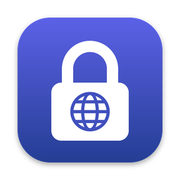

<p align="center">
  
</p>

<h1 align="center">SiteLock</h1>

<p align="center">
  Password-protected site blocking for your browsers on macOS.<br>
  macOS 13+ · Apple silicon and Intel
</p>

## Install

```bash
curl -fsSL https://github.com/AlikhanSharapov01/SiteLock/releases/latest/download/SiteLock.zip -o /tmp/SiteLock.zip && rm -rf /Applications/SiteLock.app && ditto -x -k /tmp/SiteLock.zip /Applications && rm /tmp/SiteLock.zip && open /Applications/SiteLock.app
```

Click **Install** in the app and set your SiteLock password. Updates: **Check for Updates…** in the app.

## Use

- Choose the browsers to block in under **Browsers…**: Firefox, Chrome, Edge, Brave, Vivaldi, Chromium.
- `youtube.com` blocks YouTube and its subdomains; `www.youtube.com` leaves `music.youtube.com` open.
- Unblock a site for a set time; it is blocked again automatically.
- The browser restarts after each change to load the new list.

## Uninstall

**Uninstall SiteLock…** in the app, or `sudo /Library/PrivilegedHelperTools/sitelockd uninstall`.

Anyone with admin rights can remove SiteLock; it is a barrier against impulse, not a lock against yourself.
